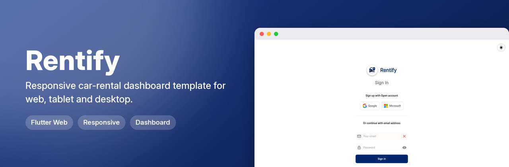
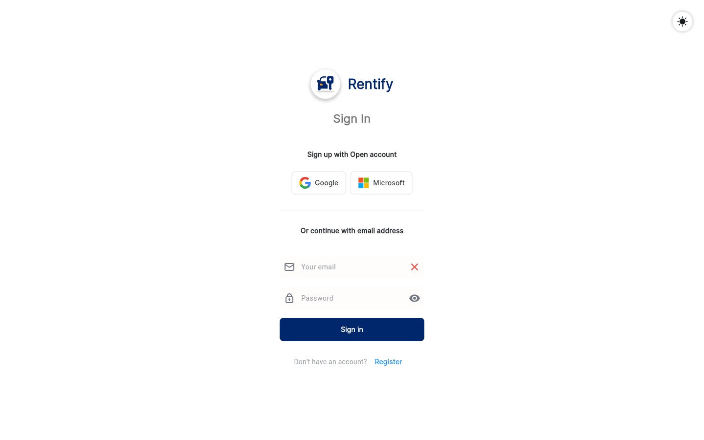
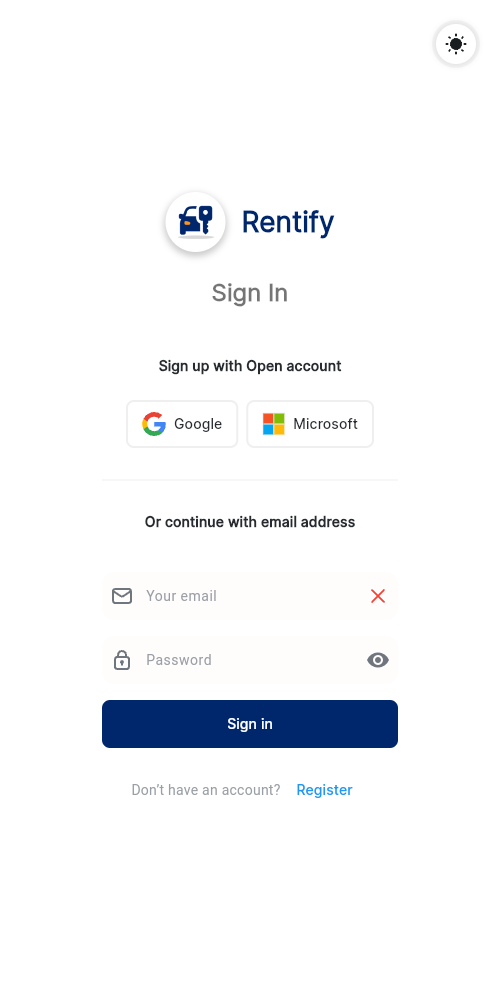
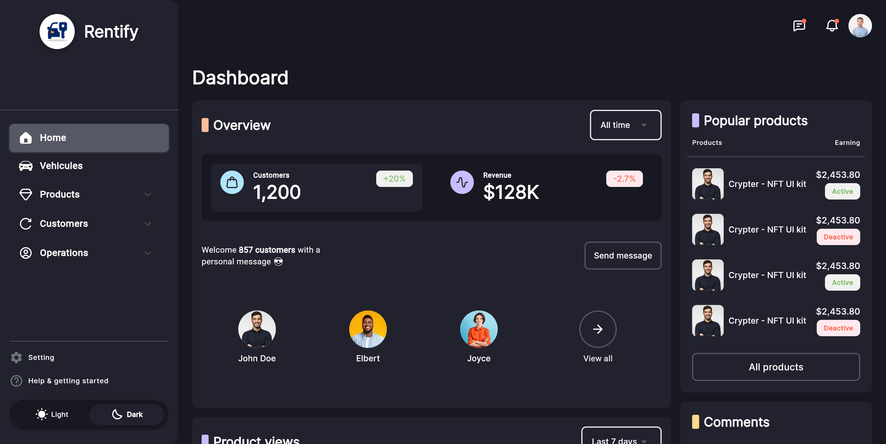
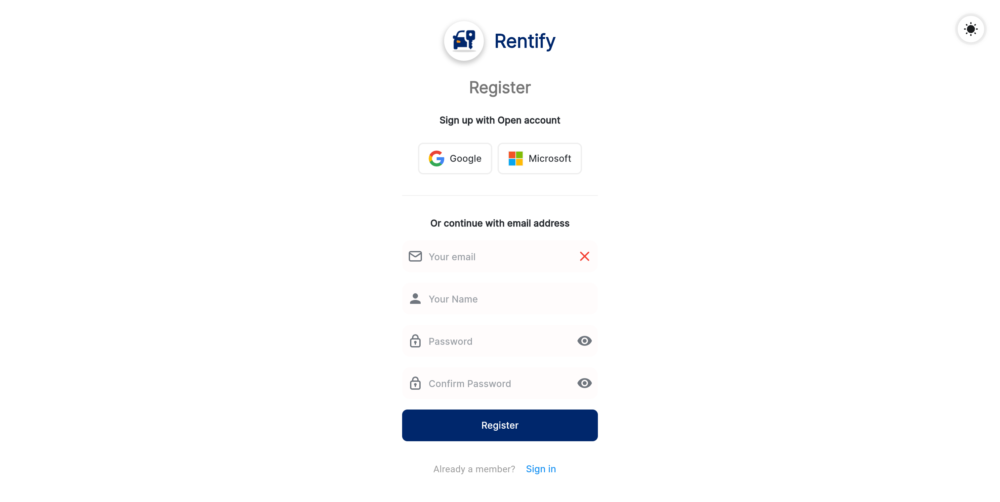
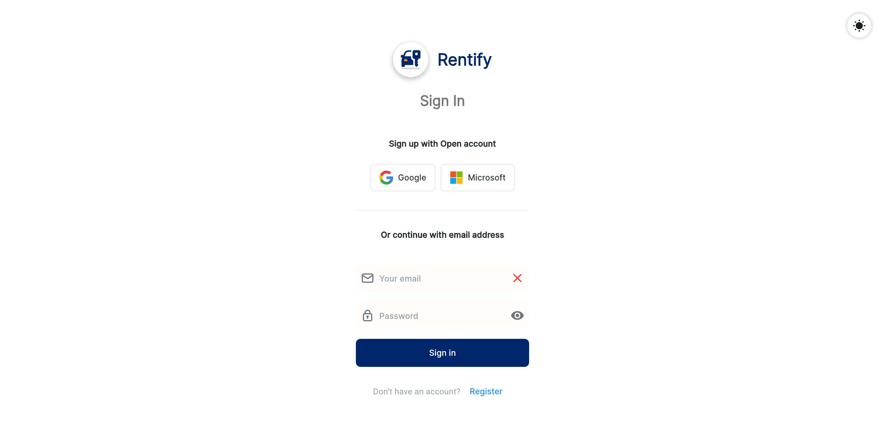
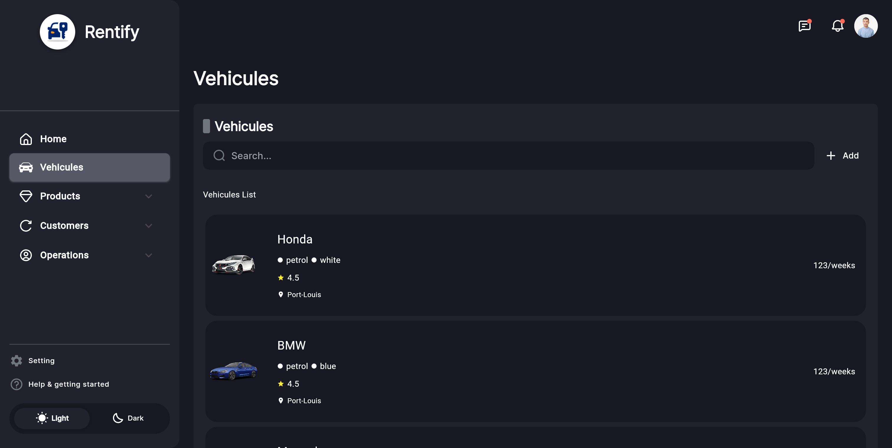
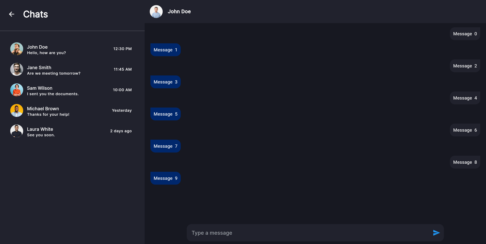

**▶ Live demo: [mohamedbenhmida-rentcar.web.app](https://mohamedbenhmida-rentcar.web.app)**

  
  

# 🚗 Responsive RentCar Dashboard Template

This is a responsive dashboard template for a RentCar web application built using Flutter. The template is designed for seamless user experience across various screen sizes, making it perfect for web, tablet, and desktop platforms.

# ✨ Features
	•	Responsive Design: Adjusts beautifully to different screen sizes.
	•	Login & Register Pages: Modern and user-friendly authentication screens.
	•	Messages Page: Manage customer queries and communication.
	•	Vehicles Management: Add, edit, and list vehicles with an intuitive UI.
	•	Dashboard: Overview of key metrics and analytics for the RentCar business.
	•	Dynamic Widgets: Reusable components for scalable development.

 
🖼️ Preview 
 
Dashboard Page

Sign up Page

Login Page

Vehicles Page

Messages Page

🛠️ How to Run
	1.	Clone the Repository:

git clone https://github.com/mohamedbnhmida/RentCarTemplate.git  
cd rentcar_dashboard_template  

	2.	Install Dependencies:

flutter pub get  

	3.	Run the App:

flutter run -d chrome  

🧑‍💻 Technologies
	•	Flutter: Frontend framework
	•	Dart: Programming language
	•	GetX: State management
	•	Google Fonts: Custom typography

🌟 Customization

Feel free to modify the template to suit your business needs:
	•	Update the color scheme in utils/themes.dart.
	•	Customize the widgets in the widgets directory.
	•	Extend functionality using the controllers directory.

📜 License

This project is licensed under the MIT License. You are free to use, modify, and distribute this template in your projects.

🚀 About

This RentCar Dashboard Template is a starting point for creating robust, scalable car rental management applications. Contributions and feedback are welcome!

Let me know if you need more modifications or further help! 😊